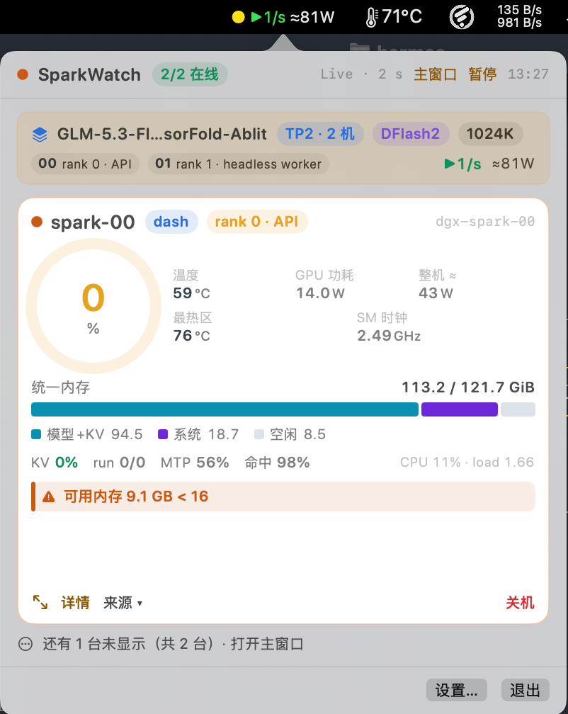
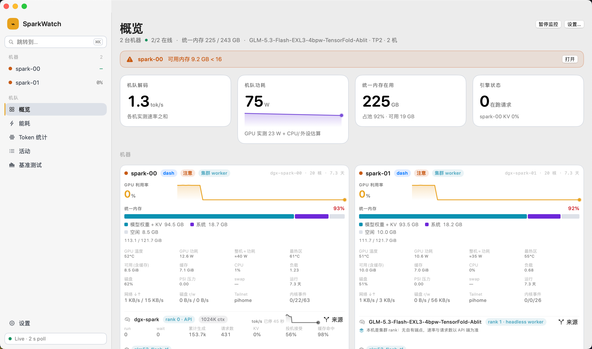

# SparkWatch

[](LICENSE)
[](#安装)
[](#从源码构建)
[](https://github.com/greatyingzi/sparkwatch/releases/latest)
[](https://github.com/greatyingzi/sparkwatch/actions/workflows/ci.yml)

[English](README.md) | **中文**

一个 macOS 菜单栏监控工具，面向一小簇 NVIDIA DGX Spark (GB10)：**硬件在干什么、
上面的模型在干什么**，一行看完。

```
DGX 2/2 · 00 95% 45° ▶28/s · 01 0% 54°
```

点开就是每台机器的完整读数：GPU 利用率/温度/功耗、**整机 CPU 利用率与最热区**、统一内存、
页缓存、PSI 内存压力、磁盘、在跑的容器，以及正在服务的模型与它的解码速度。
**被监控的机器上什么都不装**——没有 agent、没有 exporter、没有容器栈。

## 界面预览

弹窗——每台机器一张固定形状的缩略卡，健康状态与正在跑的任务在最上面，更深的细节点一下就到：



主窗口——先给机队总量，再是每台机器的面板与它的历史：



两张都是对两台 GB10 的实机运行截图。

## 功能

**一行，常显。** 节点名或圆点、GPU 利用率、实时解码速率，以及只在真出问题时才出现的告警标志——
四个预设加一个自定义。颜色承载状态，所以连 `● ●` 都仍然有信息量。见[状态栏](#状态栏)。

**两台机器当一个任务看。** 张量并行部署是从进程表读出来的，不是从端口猜的：弹窗为每个任务显示一条
横幅，每张卡说明自己的角色（`rank 0 · API` / `rank 1 · headless worker`）。worker 旧端口上那个
闲置残留引擎不会被误认成正在服务的模型。见[多机任务](#多机任务)。

**不只是硬件，还有推理。** vLLM、SGLang、llama.cpp、TGI、LM Studio、Ollama 以及任何
OpenAI 兼容端点，从端点自动识别——解码速率、队列、KV 压力、投机接受率、延迟分位、
token 与能耗账本。见[支持的推理引擎](#支持的推理引擎)。

**数字要诚实。** 速率是计数器差分，从不做平均也不外推；请求开始约 2 秒内出现，停下来后
带着"多久前测的"变灰，而不是继续以绿色撒谎。功耗分成*实测的 GPU 轨*与*估算的整机*，明确标注，
原始瞬时值就在悬停里。健康规则参照平台自己声明的上限分级，而不是会过期的固定数字。
见[解码速度](#解码速度测量与呈现)、[功耗](#功耗哪些是实测哪些是估算)与[健康规则](#健康规则)。

**渐进披露。** 弹窗里是放得下的固定高度卡片（不滚动、不重叠），主窗口是给"需要时间的东西"
用的（历史曲线、能耗、token 账本、事件流）。见[界面分层](#界面三层及其理由)。

**没有机器也能验。** `--preview` 用实时数据或合成机队（`--demo-devices 12`）离屏渲染界面，
一个无头探针把 dashboard 与独立读到的值互相对账。见[验证](#没有机器在你面前的验证手段)。

## 安装

### Homebrew

```bash
brew install --cask greatyingzi/tap/sparkwatch
```

一个 tap 装下我所有的 app，所以只需要添加这一个 tap。`brew upgrade --cask
sparkwatch` 升级；`brew uninstall --cask --zap sparkwatch` 卸载并清掉设置。
首次启动仍需下面那一步放行——Homebrew 7 已移除 `--no-quarantine`，并且会把隔离属性
传给装好的 app，所以 cask 里同样印了这条说明。

### 下载 DMG

到 [Releases](https://github.com/greatyingzi/sparkwatch/releases/latest) 下载
**`SparkWatch-0.3.0.dmg`**，打开后把 **SparkWatch** 拖进右边的 Applications 文件夹。

app 是 ad-hoc 签名（没有 Apple 开发者证书——只有付费开发者账号才能拿到），所以从网络下载的
副本会带隔离属性、被 Gatekeeper 拦下，表现为"双击没反应"。终端跑一次这条即可放行：

```bash
xattr -dr com.apple.quarantine /Applications/SparkWatch.app
```

`-r` 不能省：隔离属性也挂在 app 内部的二进制上，非递归删除会看起来"没生效"。
图形界面等价做法：右键 app → **打开** → 再点**打开**；若只给"完成"，去
**系统设置 → 隐私与安全性** 点**仍要打开**。Release 页面与 DMG 里的说明文件都写了这一步。

下载后可用同一个 release 里的 SHA256SUMS 校验。

### 安装脚本（从源码构建）

```bash
git clone https://github.com/greatyingzi/sparkwatch.git
cd sparkwatch
./Scripts/install.sh              # 构建 → /Applications → 清除隔离属性 → 注册 → 启动
./Scripts/install.sh --uninstall  # 卸载 app 与开机项（加 --purge 连配置一起删）
```

### 从源码构建

需要 macOS 14+ 与 Swift 6 工具链（Xcode command line tools 足够）。无外部依赖。

```bash
swift test                                   # 214 项单元测试
./Scripts/build-app.sh                       # dist/SparkWatch.app，ad-hoc 签名
open dist/SparkWatch.app
```

跑一次验收探针，两套实现就互相校验过了——dashboard 与经 SSH 独立读到的值对比：

```bash
DGX_PW_00=… DGX_PW_01=… swift run sparkwatch-probe -- --seconds 20
```

从源码构建大约一分钟，除了 Swift 工具链之外不需要任何依赖。

### 安装脚本给了你什么

| | |
| --- | --- |
| **启动台 / Spotlight** | `SparkWatch` 带着自己的图标出现（⌘-space → "SparkWatch"）。它是菜单栏应用，所以**按设计没有 Dock 图标**——位置在菜单栏 |
| **启停** | 像普通 app 一样启动；⌘Q 或 状态栏菜单 → 退出 关闭；**暂停监控 / 恢复监控**在弹窗按钮、右键菜单或 设置 → 通用 里 |
| **开机自启** | 状态栏菜单 → 开机自动启动，或 设置 → 通用（LaunchAgent 落在 `~/Library/LaunchAgents`） |
| **图标** | 由 `Scripts/make-icon.py` 生成（覆盖 macOS 各种尺寸 → `.icns`），脚本改动后自动重新生成 |
| **配置 / 数据** | `~/Library/Application Support/SparkWatch/` —— settings.json + sessions.json（0600） |
| **关于** | 状态栏菜单 → 关于 SparkWatch（版本、通道、配置路径） |

安装脚本会刻意删掉仓库里的构建产物：两个一模一样的 bundle 都注册着的时候，
`open SparkWatch` 可能把旧的那个给你。随时可以用 `./Scripts/build-app.sh` 重建开发副本。

### 首次启动

app 从 SSH 通道起步，并在菜单里提供 **登录 <node>…**。用那台机器的系统账号登录
（与 DGX Dashboard 网页端同一套凭据）。密码从不落盘，落盘的是 14 天有效的 token。

## 用法

### 添加机器

1. 先给机器配好 **SSH 公钥登录**（`ssh-copy-id user@host`）——这是唯一的硬性要求；
   SparkWatch 从不往被监控的机器上装任何东西。
2. 启动 SparkWatch。首次运行（还没有配置）会自动弹出设置窗口；之后随时可以
   **状态栏菜单 → 设置…**（或右键 → 设置…，或用 `--settings` 启动）。
3. **添加机器**，填名字 / SSH 主机 / 用户名。
4. 点 **扫描**：它在**那台机器上**跑一次端口扫描（8000、18300、8080、30000、11434、1234、5000…），
   把凡是像推理服务的都列出来，带引擎与模型。点一条结果就用它。
5. 点 **体检**：三项检查——SSH 通、DGX Dashboard 通且能登录、推理端点能读懂。
   密码只用于这次检查和登录，任何地方都不写。
6. **保存并应用**。

非 DGX 的普通 Linux 机器也能用：跳过 dashboard（不需要密码），它就走 SSH 通道——
硬件来自 `nvidia-smi` + `/proc/meminfo`，若你配了端点也有推理行。只有针对 GB10/Spark 的
健康规则（统一内存、PSI 压力）需要 DGX OS 或普通 Linux 的 `nvidia-smi`。

命令行等价形式（动界面之前先试，或用于脚本）：

```bash
swift run sparkwatch-probe --scan spark-b                 # find endpoints
swift run sparkwatch-probe --engine http://box:8000            # test one endpoint
swift run sparkwatch-probe --check spark-00 --password …       # full node check
```

### 状态栏

四个预设，在 设置 → 状态栏 里切换（带真实读数的实时预览）：

| 预设 | 样子 | 用途 |
| --- | --- | --- |
| 精简（默认） | `00 01 ▶32/s` | 节点名 + 实时解码速率；速率只在有 token 流动时出现 |
| 详细 | `00 93% 63° ▶28/s 01 0% 43°` | 每台机器的利用率 + 温度 |
| 极简 | `● ●` | 只有彩色圆点（每台机器一个） |
| 自定义 | — | 任选组合：节点名 / GPU 利用率 / 温度 / 内存占用 / 实时速度 / 在线数 |

颜色承载状态，所以最短的预设也仍然有信息量：绿=健康，橙=降级（或正走 SSH 回退），
红点=不健康，红 ✕=无响应，`⚠` 只在真出问题时出现。读数里永远不会出现没在测的数字——
没有计数器的引擎不会得到一个假的速率列。

### 主窗口

⌘D 从状态栏菜单打开（或弹窗的 主窗口 按钮）。248 pt 的侧边栏索引机队与它的页面——
概览 / 能耗 / Token 统计 / 活动 / 基准测试——外加每台机器一页；⌘K 打开命令面板
（跳到某页或某台机器、暂停、刷新、切换主题）。哪一页放什么、每个界面的实测容量是多少，
见[界面分层](#界面三层及其理由)。

### 配置文件（可选）

上面的一切都会写进 `~/Library/Application Support/SparkWatch/settings.json`。
支持手改——解码刻意做得宽容，所以旧版本写的文件（或缺字段）绝不会整体失败：

```json
{
  "sampleIntervalSeconds": 2,
  "slowProbeIntervalSeconds": 60,
  "nodes": [
    { "id": "…A0", "name": "spark-00", "sshHost": "spark-a", "sshUser": "operator",
      "dashboardLocalPort": 19100, "inferenceMetricsURL": "http://100.64.0.10:18300",
      "enabled": true }
  ]
}
```

会话数据在旁边的 `sessions.json`（权限 0600）。密码不存，只存 14 天有效的 dashboard token。

刻意**不用 Keychain**：条目的 ACL 绑定到创建它的那个具体二进制，而 ad-hoc 签名的构建
每次重建就换一次身份，于是每次访问都弹授权框。对一个只授予"读取我们本来就有免密 SSH 的机器"
的 token 来说，这个代价太高。改为放在 Application Support 下的 0600 文件。

## 支持这个项目

SparkWatch 是业余项目。它免费、无遥测、无账号、没有付费档位：本文档里写到的每个功能
都在你刚克隆的那份构建里，没有任何东西被藏着或锁在授权码后面。如果你的机器离线或处在气隙环境，
它就一直离线——app 只跟你的机器说话，不跟别的地方说话。

但运行它确实有成本：一张 Apple 开发者证书，让构建是签名加公证的，而不是"右键、打开"绕过
（付费账号是唯一途径）；以及开发所依赖的硬件。如果你想为此出钱，渠道是
**[Ko-fi](https://ko-fi.com/yingzi62662)**——它把付款直接转给你的 PayPal，自己不留钱，
打赏也不抽成。

它不解锁任何东西：不优先、没有额外功能、也不要求署名。你克隆到的这份构建，就是支持者拿到的那份。

比钱更有用的：

- **带具体现象的 bug 报告**——哪个引擎、哪个读数、它显示什么、你期望什么。
  [陷阱](#值得知道的坑)那一节里几乎每条都来自这样一份报告。报到这里：
  [issues](https://github.com/greatyingzi/sparkwatch/issues/new/choose)。
- **在没有的硬件上跑一次。** SGLang、TGI、ROCm、非 DGX 的 Linux 机器：这些适配器是照协议事实与
  端点抓包写的，所以真实机器就是"能解析载荷"与"已支持"之间的差距。
- **点个 star**，如果它帮你省掉了一条 shell 命令——下一个人就是靠这个找到它的。

# Technical

短的版本在上面。下面全是怎么做与为什么，大致按你会问的顺序。

## 为什么要做这个

已有的几个选项各自缺一块：

| 项目 | 它做什么 | 在这里缺什么 |
| --- | --- | --- |
| [amer8/pulsebar](https://github.com/amer8/pulsebar) | 官方 DGX Dashboard API，内存 + GPU 上菜单栏 | 单机；只认 `_in_mb`，所以对上报 `_in_kib` 的机器内存全空；没有推理 |
| [AdrianBinDC/DGXPulse](https://github.com/AdrianBinDC/DGXPulse) | 同一通道，认 NVIDIA Sync，用 Keychain | 单机；没有推理 |
| [btoro/SparkTPS](https://github.com/btoro/SparkTPS) | vLLM/SGLang 吞吐、历史、闲置告警 | 只有推理，没有硬件 |
| [leplik/dgx-spark-bar](https://github.com/leplik/dgx-spark-bar) | 最好的 GB10 领域逻辑（统一内存、PSI、低功耗卡死） | 需要在每台机器上装一个系统 agent；只有硬件 |
| [sambitcreate/sparkbar-mac-dgx](https://github.com/sambitcreate/sparkbar-mac-dgx) | 多机 + 推理 + 统一内存 | 要求某些主机上跑 sparkDash 的 Docker 栈 |

SparkWatch 是它们的交集：**同时看两台机器、走官方 dashboard 的硬件数据、vLLM/SGLang 推理，
而且不在机器上装任何东西。**

## 数据通道

1. **官方 DGX Dashboard API** —— 每台机器，走我们自己的 SSH 转发
   （`ssh -N -L 127.0.0.1:<port>:localhost:11000`），`POST /api/login` → 14 天有效的 RS256
   JWT → `GET /api/v1/gpu_telemetry/stream`（SSE，约 1 Hz）。没文档、属内部接口，
   但它是唯一能正确报告 GB10 统一内存池的来源。
2. **推理** —— 直连 tailnet 对 vLLM/SGLang 端点 `GET /metrics`。计数器是累计值，
   先按标签集（`engine`、`finished_reason`、`is_streaming`）求和，再差分成 tok/s。
   直连被挡时回退到经 SSH 取那台机器自己的 loopback。
3. **慢 SSH 探针**（默认 60 s）—— `/proc/meminfo`、`/proc/pressure/memory`、`df`、
   `docker ps`、原始 `nvidia-smi`。dashboard 漏掉的一切，外加用于对账的第二意见。

降级是显式可见的：`[dash]` → `[ssh]` → 断开。丢掉 dashboard 通道的机器继续走 SSH 工作，
不会就此变黑。

## 内建的 GB10 特性

* `nvidia-smi` 在统一内存上报告 `memory.used/total = [N/A]`，所以内存从不来自它；
  回退路径改为读 `/proc/meminfo`。
* `/proc/meminfo` 的 "kB" 其实是 **KiB**。在 Spark 上逐字节证实过：
  `127598548 × 1024 == 130660913152 == free -b` 的总量。当成 1000 就会凭空造出与
  dashboard 之间 2.3% 的分歧。
* dashboard 的字段名**按机器**不同（在两台跑着字节相同二进制的机器上验证过，
  `md5 292142e5…`）：一台上报 `memory_total_in_kib`，另一台上报 `memory_total_in_mb`。
  两者都被解析并归一化成字节；字段缺失时隐藏该行，而不是打印 0。
* `power_limit_in_w`、`gpu_memory_in_use_in_mb`、`cpu_memory_in_use_in_mb` 在 GB10 上
  恒为 0（即使有 104 GB 的 vLLM 常驻），所以没有建模。
* 健康规则使用字段自报的阈值（见 `Sources/SparkWatchCore/Health.swift`），
  包括有文档记载的"忙着的 GPU 只吃 ~14 W"卡死形态——那种状态下 Spark 只剩四分之一速度，
  而所有指标看起来都还是绿的。

## 支持的推理引擎

从端点自动识别——不需要设引擎。"已实测"指对着一台真实服务器验过；载荷形状在单元测试里。

| 引擎 | 怎么识别 | 卡片显示什么 | 实测 |
| --- | --- | --- | --- |
| **vLLM** | `/metrics` 且含 `vllm:` 族 | token、running/waiting、KV%、tok/s、模型、请求数 | ✅ spark-a :18300 |
| **SGLang** | `/metrics` 且含 `sglang:` 族 | 与 vLLM 同族，外加原生吞吐 | ⚠️ 只有族名（这里没有活的 SGLang） |
| **llama.cpp** / llama-server | `/metrics` 含 `llamacpp:` + `/v1/models` 的 `meta` | token、processing/deferred、原生 tok/s、投机接受率、量化、上下文、参数量 | ✅ llama-server 0.4.1 (Qwen2.5-0.5B) |
| **LM Studio** | `/api/v0/models` | 模型、加载状态、量化、架构、上下文；**无计数器** | ✅ :1234 上的 server |
| **Ollama** | `/api/ps` | 已加载模型、VRAM、量化、参数量；**无计数器** | ✅ spark-b :11434 |
| **TGI** | `/metrics` 含 `tgi_` 族 | token、批大小、队列 | ❌ 只有名字——没有活的 TGI 可测 |
| 任何 **OpenAI 兼容** | `/v1/models` | 模型名 + 可达性 | ✅ 走 llama.cpp 那条路 |

引擎报不出速度时，卡片会直说（"该引擎不提供速率/请求计数"），而不是留一个空读数。

这张表存在就是为了记录这些坑：

* **LM Studio 对 `GET /metrics` 返回 HTTP 200 加一个错误体。** 状态码什么都证明不了；
  要校验响应体（`looksLikeMetrics`）。
* **llama.cpp 不带 `--metrics` 时返回 501。** 想要 token 计数就用 `--metrics` 启动；
  否则卡片只退回到模型事实。
* **vLLM 在 `/` 上返回 404** 但其实服务正常，所以"可达"指"任何 HTTP 应答"，不是 2xx。
* **Ollama 与 LM Studio 默认只监听 loopback。** SparkWatch 经 SSH 通道（在机器上 curl）
  够到它们，什么都不暴露——见 `SshCurlTransport`。把 URL 指向机器的 tailnet 地址也行，
  前提是你把 server 绑到那上面。
* **Ollama/LM Studio 没有计数器。** 它们的 API 就是不报 token；app 显示模型与 VRAM，
  而不是编一个数字出来。

## 健康规则

阈值取自 `joeynyc/spark-doctor`(MIT)——是字段自报的 DGX Spark 行为而非案头猜测——
但严重度在统一内存让原判读失真的地方重新分过级。

| 级别 | 触发条件 |
| --- | --- |
| **异常**（critical, ⚠） | 节点不可达（两个通道都断）· GPU ≥ 90 °C · ACPI 区距**平台声明的上限** 6 °C 以内（这里是 104 °C）· 内存 PSI `full avg10` > 0.25 · MemAvailable < 2 GB · MemAvailable < 8 GB **且** PSI > 0.25 · GPU 忙 ≥ 80 % **同时功耗 ≤ 25 W 且 SM 时钟塌到 ≤ 800 MHz** 连续 3 个采样（有文档记载的低功耗卡死） |
| **注意**（warning） | GPU 85–90 °C · ACPI 区距上限 12 °C 以内 · PSI 0.10–0.25 · MemAvailable 8–16 GB · MemAvailable < 8 GB 且 PSI ≤ 0.25（常驻模型把地板占住——正常）· swap 已用 > 8 GB · 1–2 个低功耗采样 · 慢通道错误 |
| **正常** | 以上都不是 |

菜单栏里的 ⚠ 是另一个标志：只有"绿色 dashboard 会掩盖"的情况（不可达、热、内存压力停顿、
低功耗卡死）才会点亮它。一台正在满负荷干活的机器不该常年挂着告警。

低功耗卡死的规则也必须收紧。`utilization.gpu` 表示"有 kernel 驻留"，不代表在干活：
在张量并行的一对里，等对端链路的那一级能读到 90%+ 而只吃 ~20 W，机器空闲时是 2411 MHz。
结果是健康的一对机器上常年挂 ⚠——实测 96% / 23 W **而解码速度是 27–65 tok/s**。
卡死有另一个特征：*时钟塌掉*，这正是 spark-doctor 自己的规则点名的置信信号。所以现在
时钟是必需条件而不是提示，且时钟未知时永不升级告警（一个没人能处理的告警，比一个没被发现的
卡死更糟）。负载实测：95% / 42 W / 2411 MHz 保持"注意"，卡死告警 0 次。这顺带暴露了一个
真实的数据流 bug——dashboard 流每秒整体替换 GPU 采样，把只有 SSH 通道能填的时钟字段冲掉了，
所以这条规则其实从来没见过时钟。

ACPI 区那条规则也是在它对这对机器产生常年 ⚠ 之后重写的：持续推理下这些区在 78–91 °C，
而平台为它们声明了 **104 °C** 的上限（从区自己的 trip point 读到），所以写死 90 °C 会让一台
健康的机器整天显得危急——这是最快的"教会人忽略这个图标"的方式。GPU 轨保留绝对的 85/90，
因为 GB10 没给出任何可以相对的基准：`temperature.gpu.tlimit` 返回 `4`，所有关机/降频上限
都是 `N/A`。

与 spark-doctor 的数字有两处刻意偏离：`MemAvailable < 8 GB` 是**注意**而非异常，因为在统一内存上
常驻模型会把 121 GiB 的机器压到 7–8 GB，而 PSI 保持 0.00——并没有谁在等内存，PSI 才是升级条件
（低于 2 GB 无论如何仍是异常，因为 OOM 在即）。原来那条 `MemAvailable/MemTotal < 15 %` 的规则被删掉了：
在任何合理的机器容量下它都与绝对阈值同时触发，只是把同一个条件回声到第二行。

## 解码速度：测量与呈现

速率是**计数器差分**：每次探测（机器在干活时 2 秒一次，闲时 6 秒一次）读引擎的
`completion_tokens_total`，tok/s 就是增长量除以经过的时间。不做平均，也不外推——
计数器没动的探测不产生任何速率。

这留下一个呈现问题，而 app 一开始答错了：在最后一个 token 到下一次探测之间、以及请求结束后
的一段时间里，最近一次测量仍然是最近的**事实**——但把它用与实时速率相同的亮绿色显示，
等于宣称"这正在发生"，而那是假的。修法是三态，由测量的年龄决定（引擎能报的话，
再叠加"是否还有请求在跑"）：

| 状态 | 何时 | 怎么显示 |
| --- | --- | --- |
| **live** | 12 秒内测到 | 绿色 `▶47/s` |
| **stopped** | 更久，但不超过 2 分钟 | 灰色 `▶47/s · 已停 32秒`——数字仍然真，宣示不真 |
| **hidden** | 超过 2 分钟，或从未测到 | 该行显示 已停止（若从未跑过则显示 空闲） |

菜单栏只说现在时：陈旧的速率永远进不了状态栏。

实现过程中冒出两个 bug，都值得点名：

- `TokenRateTracker.age()` 起初是拿**最后一次探测**的时间戳算的，而不是**最后一次计数增长**的时间戳。
  由于探测每轮都会刷新那个时间戳，年龄永远是 ~0，于是什么都判不出"陈旧"——速率一直亮着。
  这正是"推理停止了但速度没降下来"背后的机制。
- 引擎报告 `running == 0` 是权威的：请求一结束，数字立刻变灰，而不是等新鲜度窗口走完。

对着一个真实的（慢速）请求端到端验证过：`hidden → live(▶3/s，菜单栏同显 ▶3/s) → stopped(11 秒…96 秒，
菜单栏静默) → hidden`。三个状态都有单元测试覆盖，包括追踪器的"最后速率与年龄"行为。

### 快显慢隐：两端刻意不对称

一个速率只有在事情还在发生时到达才有用，也只有在它不闪烁时才读得下去。这两个要求互相拉扯，
所以两端分别调。

**出现的时间由探测决定，不由固定时钟决定。** 节奏跟随最便宜的信号——dashboard 流里约 1 Hz 的
GPU 利用率与功耗，加上引擎自报的在途请求：

| 状态 | 节奏 | 为什么 |
| --- | --- | --- |
| 干活中（利用率 ≥ 15 %、或 ≥ 25 W、或引擎自报有在途请求） | **2 秒** | 请求开始后的第一个速率必须几乎立刻到；固定 5 秒的节奏正是被人感觉到的那个延迟 |
| 安静 | **6 秒** | 每个探测对一个只监听 loopback 的引擎都要一次 SSH 往返，而闲置的计数器没有新东西可说 |

循环每 400 毫秒醒一次，这样节奏才真的被遵守——2 秒的节奏配 2 秒的 sleep 会漂成 4 秒。

**请求的第一个读数会做稀释检查。** 速率是两次探测之差，所以一个在工作开始之前就开始的区间里
混着空闲时间：一个在 6 秒空闲区间的第 1 秒开始的请求只会读到真实速度的五分之一，然后再跳上去。
与其快而错，不如把这个第一个读数丢掉（探测照旧重建计数器基准），几秒后那一个——整段都在忙期内
——才是准的。

**消失带迟滞。** 有活干的消息来得和探测一样快；干完活的消息要等：

| | |
| --- | --- |
| 12 秒内测到 | live——漏掉两次探测不会让任何东西变灰 |
| 引擎说没有在跑，且距上次测量 ≥ 6 秒 | 灰——这段驻留时间阻止了"两个请求之间的间隙闪一下" |
| 120 秒没有测量 | 消失 |

探测失败也不再抹掉数字：它保留最后一次测量及其年龄，所以一次端点抖动只会让它变灰
（并照常过期），而不是直接掉成"已停止"。

### 为什么第一个数会偏低，以及那为什么不是显示的锅

在一个真实请求上实测（每次探测的轨迹，时间以请求开始为原点）：

| | 改之前 | 改之后 |
| --- | --- | --- |
| 显示的第一次值 | +1.1 秒——**7.5 tok/s**，被前面 5 秒空闲稀释 | +2.0 秒——14.1 tok/s，对它那个窗口是诚实的 |
| 真实持续速率 | +5.7 秒 | +4.6 秒 |

旧的时序由两个缺陷造成，形状相同——*刷新器吃掉了判断所依赖的信息*：

- 区间守卫是在追踪器 `update()` **之后**求值的，而 update 会刷新"最后一次探测"的时间戳，
  于是间隔永远量到 ~0，任何被稀释的读数都不会被拒绝；
- `TokenRateTracker.age()`（更早）量的也是那个被刷新的时间戳，于是什么都判不出陈旧。

守卫修好后，区间跨过空闲时间的读数会被丢掉，采集器 0.3 秒后就再探一次以建立干净基准——
这就是"什么时候出现东西"从 +1.1 秒改善到 +2.0 秒的原因。

剩下那 2 秒才到真实值，是引擎的事而不是显示的：请求开始后的第一个窗口里混着 prefill 的尾巴
和草稿模型的预热，那个窗口里实际只产出了约 24 个 token。那个低值是那个窗口的真实值。
（引擎自己的 `decode_seconds_total` 本来被解析出来正是为了避免这件事，然后**刻意没有用**：
这个引擎是批量刷新的，所以一个 2 秒的窗口能看到 4.4 秒的"解码时间"——它对一个跑在 52 的工作
读到 17.9 tok/s。刷新粒度比采样窗口还粗的计数器，比墙钟更差，不是更好。）

## 功耗：哪些是实测，哪些是估算

关于功耗数字，同样实话实说：**两个值，只有一个实测。**

- **GPU 功耗——实测。** NVML 的 `power.draw`，它在 GB10 上只覆盖 SoC 的 GPU 轨，别的不含
  （在机器上验证过：`GPU Memory Power Readings` 与 `Module Power Readings` 都是 `N/A`，
  所有功耗上限都是 `N/A`，没有 RAPL、没有 hwmon 功耗传感器、没有 USB-C PD 遥测、没有 BMC/IPMI
  设备——`ipmitool` 装了但 `/dev/ipmi0` 不存在）。官方 DGX Dashboard 流的是同一个数字
  （`power_draw_in_w`，与 `nvidia-smi` 一致），所以机器上没有更好的来源。一份独立的
  NVIDIA 论坛 GB10 能耗遥测审计从另一边得到同样结论：DCGM 的 CPU/SysIO/Module 功耗字段
  虽然认得，但恒返回 `0.000`，六条 I2C 总线是空的（板上没有 INA 电流监测），把 8 个 CPU 核
  全跑 15 秒对 GPU 能量计数的改变恰好是零——Grace 的 CPU 轨根本没有仪表。

- **整机≈功耗——估算，并且这样标注。** 由单台 Spark 的两个功率计锚点解出，`wall = 12 W + 2.20 × gpu`：

  | 状态 | GPU 轨 | 整机 | 来源 |
  | --- | --- | --- | --- |
  | 空闲，无模型 | 11.8 W | 38 W | Kill-a-Watt（社区） |
  | 生成中 | 47.7 W | 117 W | Shelly，双机对 234 W / 2 |

  两个锚点都能被出厂默认值复现，且 app 会打印 `≈`（GPU 轨本身未知时显示 `--`，而不是编一个数字）。
  预期 ±20 %：它只以 GPU 轨为输入，所以一台 CPU 忙而 GPU 闲的机器会读低。两个系数都可以在
  设置 → 功耗 里改——前面接上计量插座之后就在那里修正。

  作为量级参考，社区对单台 Spark 的整机实测：空闲 25–45 W，单次推理突发 125–170 W，
  纯 CPU 满载 120–130 W，双机不锁频 ~330 W 对比锁在 1400 MHz 的 ~234 W。（这个锁频值得知道：
  它花掉约 3 % 解码速度，省下双机合计约 90–100 W。）

关于 CPU 数字，同样实话实说：GB10 **不暴露 CPU 封装温度传感器**。所以卡片显示最热的 ACPI 热区
（`/sys/class/thermal`）并标注为 最热区，而不是假装那是 CPU 封装读数。CPU *利用率* 是真的：
同一次 SSH 调用里相隔一秒读两次 `/proc/stat`，因为探针是无状态的。（供参考，这台机器另外的
热源是 NVMe SSD 约 41–44 °C、ConnectX-7 ASIC 约 48 °C。）

### 滚动窗口均值，因为原始数字没法读

在张量并行的一对上，原始 `power.draw` 摆得非常厉害——不是故障，只是每一级在计算突发与等待
对端链路之间交替。在这对机器负载下实测（50 个采样，间隔约 1.3 秒）：

| | spark-00 | spark-01 |
| --- | --- | --- |
| 原始范围 | 50.7–84.6 W | 43.3–84.8 W |
| 相邻采样跳变（均值 / 最大） | 9.4 W / 33.8 W | 10.4 W / 37.8 W |

所以显示的值是**滑动窗口的尾部均值**，而窗口用秒表达，因为那是这里唯一有意义的单位：
振荡周期约 2–4 秒，短于一个周期的窗口只会与它共振。

| 窗口 | 残余跳变（均值） |
| --- | --- |
| ~4 秒 | 4.07 W——与周期共振，帮助不大 |
| ~6.5 秒 | 2.52 W |
| **~10 秒（默认设置 8 秒）** | **1.71 W** |
| ~13 秒 | 1.06 W——最平，但肉眼可见地滞后 |

默认：**8 秒**（设置 → 功耗 → 显示平滑，0 = 原始值）。经 app 自己的数据通路实测：
显示的跳变 1.70 W / 1.79 W，对应原始跳变 13.78 W / 15.00 W——降低 88 %，
代价是请求开始或结束时约半个窗口的滞后。

两条规则让它保持诚实。**原始采样被保留**（`powerInstantW`）并显示在卡片的悬停提示里——
"8 秒窗口平均 67.3 W（瞬时 84.0 W）"——因为一个没人能对照瞬时值核对的平滑数字，只是一个
更好看的谎。而均值会喂给所有消费者，包括低功耗卡死那条规则——那里"持续"正是均值所测的东西；
整机估算顺势继承。

## 多机任务

一个分布式部署不是两台服务器——是一个带角色的任务。app 从机器的进程表里读出拓扑
（慢通道，只读），而不是从端口猜：

| 读什么 | 为什么 |
| --- | --- |
| `--nnodes`、`--node-rank` | 这是一个摊在 N 台机器上的任务吗，这台是第几级 |
| `--headless` | 这一级**完全不提供 HTTP**——它旧端口上应答的任何东西都属于另一个（通常闲置的）引擎 |
| `--tensor-parallel-size` | TP2 表示模型被切到两台机器上，各持一半 |
| `--master-addr`/`--master-port` | 会合地址——真正把两个进程绑成一个任务的东西 |
| `--served-model-name`、snapshot 路径 | 任务在服务什么（snapshot 哈希被剥掉，这样 key 能挺过重新部署） |
| `VLLM::Worker_TP<n>`（进程标题） | 本地 worker 级，印证 `--node-rank` |

弹窗随后在每台机器的卡片上方为每个任务显示一条横幅：

```
GLM-5.3-Flash-EXL3   TP2 · 2 机   EXL3   830K ctx
00 rank 0 · API      01 rank 1 · headless worker      一次请求同时压两台
```

每张卡也说明自己的角色（`rank 0 · API` / `rank 1 · headless worker`）。

对着一个活的机对验证过（`vllm serve ... --nnodes 2 --tensor-parallel-size 2
--quantization exl3 --max-model-len 850000`）：两张卡现在都报 `GLM-5.3-Flash-EXL3`——
之前 rank 1 显示的是 *ollama*，因为一个闲置的 Ollama 还在它旧端口上监听，而单机探针
没有办法知道这台机器已经不干 Ollama 服务器、改成 TP worker 了。端点现在由 API 级自己的
`--port` 推导（`http://spark-a:8888`），headless 级的陈旧 URL 被清掉，而且观察到单个请求下
两块 GPU 都跳到 95–96 %——这才叫"跨设备并行"。

几个值得知道的推论：只有 API 级能报 tokens/s，所以菜单栏的速度不会被重复计算；
headless 级的推理行由拓扑填充（它跑的正是这个任务的模型），而不是来自一个注定失败的探针；
两个独立的、跑同一个模型的单机副本会刻意**不**合并——没有会合地址就没有任何东西把它们绑在
一起，合并等于凭空造出一个不存在的任务。

### 部署横幅那一个实时位

横幅在一个位置里用优先级阶梯回答"现在在发生什么"——先解码速率，再 prefill，再在途请求数——
因为其中永远只有一个才是答案，而在 400 pt 宽度下横幅塞不下三个。

里面有两件事必须修：

- **问每一个节点，而不是第一个。** 阶梯原本读的是 `nodes.first.inference`，而 headless worker
  自己没有速率（它不提供 HTTP）。当 worker 在快照数组里排第一时，一个正以 63 tok/s 解码的部署
  会宣布"处理中 ×2"。部署级数字必须跨整个部署收集。
- **标注空缺，而不是错误填充。** 速率是计数器差分，所以刚启动后的几个采样没有它——
  而那个窗口以前会掉到"处理中 ×N"，读起来像"这里永远没有速度"。当引擎报告它正在解码
  （`/health` 的 streams）但速率还不存在时，横幅现在说 **▶ 测量中…**。对着一次启动验证过：
  6 个采样的"测量中"，随后随着计数器差值落地显示真实的 ▶63/s、▶60/s、▶50/s。

worker 也不再凭空造一个它不可能知道的在途数：它以前报 `running = 1`（意思是"这一级起来了"），
而菜单栏把它读成一个在途请求——于是一个空闲的部署上永远挂着 ×1。

## 选择显示哪个推理服务

端口扫描不可能知道意图。就在这对机器上，rank 1 是一个**完全不提供 HTTP 的 headless TP worker**，
而一个几个月前的**闲置 Ollama** 蹲在 `127.0.0.1:11434`——对扫描来说两者都像"一个推理服务"，
选错那个就会把一个陌生人的数字当成这台机器在服务的东西报出来。

所以扫描负责提议，用户负责决定。每台机器的卡片（详情窗口）与每一行（设置 → 监控的机器）
都带一个 **来源** 选择器：

| 选择 | 行为 |
| --- | --- |
| 自动（默认） | 拓扑优先——TP 级显示任务的模型与它的 rank；否则用最有把握的扫描结果 |
| `:8888 · vllm · GLM-5.3-Flash-EXL3` | 钉住：只探这一个，失败就直说，而不是漂到别的服务上 |
| `:11434 · ollama · 仅本机` | 陈旧残留也会被列出来——钉住后它显示的是*它*的真实状态（这里：没加载模型） |
| 不显示 | 隐藏这台机器的推理行，也不做任何探测 |

候选来自机器自己的进程表与其监听套接字的连接（`InferenceCandidates`，有单元测试）：
一个端口自己说不清它是 vLLM 还是一个残留的 Ollama，一个进程自己也说不清它在哪个端口应答。
两条规则重要——headless 级的 `--port` **不**被提供（它在那里什么都不服务，会变成一个死选项），
而一个在已知端口上监听、却没有进程解释的监听者**会**被提供（容器化服务就长这样）。
绑在 `127.0.0.1` 上的服务标注为 仅本机，并经 SSH 通道钉住——请求是在机器本身上执行的。

钉住或隐藏的行是明确的指令：集群层会让位，不再覆写它们。选择存在配置文件的 `inferenceSource` 里
（`{"auto":{}}`、`{"pinned":{"_0":"http://…"}}`、`{"hidden":{}}`），所以一份交给别人的配置文件
会把决定一起带过去。

## 界面：三层及其理由

一个信息密集的监控工具有一个结构性问题：你在第一层界面上放的东西必须放得下，
放不下时操作系统就会挤压它——文字重叠正是这么来的。解法不是更小的字号，而是
**渐进披露**：每一层有明确的容量规则，再加一个完全没有容量限制的界面。

```
L0  菜单栏       一行：圆点/名字 + 利用率 + tokens/s + ⚠   （常显）
L1  弹窗         放得下的缩略卡 + 一行溢出提示            （从不滚动）
L2  主窗口       侧边栏 + 机队页面 + 每机详情              （可缩放、可滚动）
```

L2 是新的。在此之前，"所有东西"住在一个只能把机器并排摆的详情窗口里；任何需要*时间*的东西
（历史曲线、24 小时能耗、token 账本、事件流）都没有容身之处。主窗口就是那个地方：
248 pt 的侧边栏索引机队与机队级页面，概览页上每台机器一张卡。

**L1 弹窗——只放放得下的。** 每台机器一张形状固定的卡片：身份 + 健康，一个 88 pt 的**环**
表示 GPU 利用率，旁边是温度 / GPU 功耗 / 拟合的整机瓦数 / 最热区，统一内存的**分账**，
一行 `statline` 的引擎计数器，以及一排动作按钮（详情 / 来源 / 关机）。字段集是常量、
每个值都是单行，所以高度是已知的而不是期望中的：**每张卡 302 pt**，弹窗能放几张由真实屏幕算出
（`NSScreen.visibleFrame`，不是常量）。

实测容量与高度（渲染器输出，不是算术）：

| 可用高度 | 卡片 | 渲染高度 | 放得下？ |
| --- | --- | --- | --- |
| 780 (1440×900) | 2 | 758 pt | 是，余 22 pt |
| 780 + 第三台机器 | 2 + 溢出提示行 | 778 pt | 是，余 2 pt |
| 1360 (2560×1440) | 3 | 1087 pt | 是 |

这张表逼出了两件事，都是靠测量而不是靠推理发现的：溢出提示必须变成一行纯文本
（带边框和内边距的版本把三机弹窗推到 792 pt，超出预算），以及卡片高度固定为 302 pt——
因为"卡片随数据长高"正是当初文字重叠的原因。

**L2 主窗口——所有东西。** ⌘K 打开命令面板（跳到某页或某台机器、暂停、刷新、切换主题）。
页面有：概览（机队 KPI + 每台一张卡）、能耗、Token 统计、活动、基准测试，外加每台机器一页。
入口在状态栏菜单的 ⌘D，以及弹窗的 主窗口 按钮。

### 并排对比窗口的列布局

*对比*窗口（状态栏菜单 → 并排对比窗口）仍然是它一直以来的并排网格：等宽、整组居中、
上限 560 pt，机队放不下就滚动。它存在的意义是在某一个瞬间比较 N 台机器；主窗口存在的意义
是在时间上浏览它们。两个窗口，两份职责。

### 列布局：1 / 2 / N 台

列**等宽**、**整组居中**、**有上限**——按人注意到的顺序排列。左对齐、余量全堆在右边的列，
正是让窗口"感觉不对"的原因；而等宽是两台机器可以比较的前提。

| 机器数 | 1180 pt 宽的窗口 | 结果 |
| --- | --- | --- |
| 1 | 1 列 × 760 pt，居中 | 单机得到更宽的卡片（旁边没有东西要对齐），仍然有上限，文字不会被拉长 |
| 2 | 2 × 560 pt，居中 | 铺满宽度；560 是上限，所以更宽的窗口加的是对称留白，而不是荒谬的行长 |
| 5 | 2 列可见，3 台滚动 | 在 ≥ 380 pt 的前提下放尽可能多的等宽列；页脚写"另有 3 台在右侧，横向滚动查看" |
| 12 | 2 列可见，10 台滚动 | 同一条规则——机队在滚动里累积，绝不靠缩小卡片 |

这些数字来自 `LayoutPolicy.detailLayout`（core 里，有单元测试），不是来自视图：
视图测量自己的宽度，然后向它要一个布局。用 1/2/5/12 台的离屏渲染验证过——实测留白
1 列和 2 列居中偏差 0 px / 6 px——以及给真实窗口截图（1180×682，在 1440 pt 屏幕上 x = 130，
即恰好居中）。

**不拥有 N 台机器也能验证 N。** `--demo-devices N` 注入一个合成机队，覆盖界面可能处于的
每一种状态（健康、负载、告警、危急、不可达、连接中、headless TP 级、无端点），
再由 `--preview`/`--preview-detail` 离屏渲染它：

```bash
SparkWatch --preview /tmp/pop12.png --demo-devices 12      # popover, 12 machines
SparkWatch --preview-detail /tmp/d8.png --demo-devices 8   # detail window, 8 machines
```

在 1440×900 屏幕上、可用高度 780 pt 下的渲染高度：

| 机器数 | 弹窗高度 | 显示 | 溢出 |
| --- | --- | --- | --- |
| 1 | 250 pt | 1（满宽） | — |
| 2 | 310 pt | 2 | — |
| 5 | 628 pt | 5 | — |
| 12 | 664 pt | 8 | +4 在溢出提示行里 |

布局检查是机械的，不靠眼睛：渲染图被 OCR，然后比较词框的**跨行碰撞**（位于不同文字行却相交的框）。
同行内的框重叠被忽略——OCR 会把中日韩字形切成相邻的松散框，把它当缺陷只会得到假警报。
以上全部渲染均零跨行碰撞、无内容被裁。

## 主题、环形表与配色

四套主题：`跟随系统`（默认，随 Mac 的浅/深色走）、`白色`、`浅色`、`深色`、`纯黑 OLED`。
令牌与 hex 取自已核对的参考项目（White `#F3F4F6/#FFFFFF`、Light `#DCE0E7/#FFFFFF`、
Dark `#0A0C0F/#12151A`、OLED `#000000/#0B0C0E`，琥珀强调色 `#E8A21C`/`#F0B03A`）。
显式主题下 popover 与窗口**自己刷底色**，不用系统 material —— 实测过 material 会跟着
Mac 的浅深色走，于是出现「深色卡片 + 浅色标题栏」的半截主题；`跟随系统`才用原生 material。

**环形表**（`Ring`）替代了长条作为每机主指标：

- 几何：底轨整圆 + 前景弧、`round` 端点、12 点起顺时针、`dashoffset = C×(1−v/100)`，
  环心字号 = `size×0.32`。**不做** 270° 开口弧（白扔 1/4 弧长分辨率，且「转满一圈」
  本身没有语义）。
- 尺寸三档：popover 88/8、详情 140/11、并排两个量时 88/8。
- **一个环只放一个数**，其余的量放环外 —— 两个数抢一个环比两条长条更差。
- 实测：同样 2 台机器，环形布局 700 pt、长条布局 734 pt（旧实现）。环不只是好看，
  它把「标签 + 条 + 数值」三个角色折进同一个方块。

**配色铁律**：颜色只在**规则触发**时出现，不套 0–100 色阶。

| 指标 | 色阶 |
| --- | --- |
| GPU 利用率 | 一直是强调色（琥珀）——利用率是**量级**不是状态；只有降频或温度规则触发才升级 |
| GPU 温度 | <85 °C 灰、85–90 黄、≥90 红（对齐 Health 规则本身） |
| 统一内存 | <85% 蓝、85–90% 黄、≥90% 红（健康规则另有绝对余量与 PSI 判据） |
| KV 占用 | <50% 绿、50–80% 黄、≥80% 红 |
| 降频/内核事件 | 直接危险色 |

把 95% 利用率画成红色，等于给每一台正常干活的机器挂一个假警报 —— 这是我们自己在
温度上踩过的坑，利用率同理。

## 每机详情页：分面板，而不是一张大卡

一张卡要在一屏里回答「它在干什么」，所以 popover 只有 302 pt。窗口有地方回答下一个问题——**为什么**——
那需要把部件分到各自的面板里，让相同单位的东西彼此相邻（两个百分数并排、两个温度并排）：

```
GPU（环 140 + 温度/功耗/SM 时钟/降频 + 显存进程 top5）
统一内存（分账条 + 可用/页缓存/PSI/swap）
CPU（利用率/最热区/距上限 + 负载/运行时长）
LLM 服务（模型 + 解码/prefill + 指标瓦片 + 基准入口）
存储（用量条 + 实时 r/w） · 网络（各接口 rx/tx + 协商速率）
Tailnet（地址/路径/密钥） · 负载与内核事件（容器 + Xid/OOM/显存分配失败）
```

两条从 popover 继承的规矩，是它读起来像仪表而不是像报表的原因：

1. **引擎没报的瓦片不渲染**。一个恒显 `--` 的瓦片会把「这台引擎没有这个能力」翻译成「这个值是零」，
   而我们拒绝的正是后者。
2. **每个指标用自己的阈值族**，温度永远不套利用率的色阶。

## 引擎延迟分位

`TTFT 均值 / TTFT p95 / E2E p95 / ITL p95` 直接来自引擎的 Prometheus 直方图，**在三个说不上来的地方返回空而不是猜**：

- 引擎根本没导出这条直方图（TensorFold 不导出 ITL → 瓦片消失）；
- 桶与 `_count` 对不上（半截抓取，参考实现同样拒绝出数）；
- 目标落在 `+Inf` 桶里 —— 导出的边界框不住它。实测这对机器上 request-latency 的 p95 就落在尾巴里（返回空），
  而 TTFT p95 干净地落在 ≈31 秒。

均值与 p95 的关系本身就是信息：这台机器 TTFT 均值 36.6 s 而 p95 30.3 s —— **均值高于 p95**，
说明少数超长 prefill 把均值拽上去了，只看均值会得出错误结论。

## GPU 历史曲线与它背后的账本

**曲线必须平移，不能"呼吸"。** 用户报的「每次刷新，所有曲线都在变」有三个来源，全部是
"跟着 `now` 连续滑动"造成的；三处都不是视觉问题：

| 位置 | 原来 | 后果 |
| --- | --- | --- |
| `GpuHistory.binned` | `start = now - window` | 桶边界随刷新滑动 → 每个桶重新平均 |
| 窗口/桶宽 | `min(请求, 可用跨度 × 1.1)` | 数据每 2 秒长一点 → 整图重新缩放 |
| 账本落盘 | `lastSave = now` 后又让 `save()` 检查 `now - lastSave >= 30` | **永远不落盘**（只有事件/退出才写） |

三处的修法是同一条：**把边界钉在绝对时间上，且只由用户选的那一档决定。**

- 桶边界锚到桶宽的整数倍（`ceil(now / width) × width`）：一个桶周期内结果逐字节相同，
  跨过边界时整条曲线**左移正好一格**。
- 桶宽只由请求跨度决定（30 min → 20 s，1 h → 40 s，8 h → 320 s），窗口按**整桶**向上取整，
  于是几何只在"又攒满一个桶"时变一次。这段逻辑抽到 Core 的 `GpuChartScale` 纯函数里，
  因为埋在视图里就没法测。
- 落盘交给 `save()` 一家管，调用方不许提前改 `lastSave`。实测修复前 75 秒零写入，修复后
  160 秒新增 99 个点（间隔 1–2 秒，与设计一致）。

**怎么验的**（截图不可靠：这条曲线自相似，平移一格和重新平均长得一样）：

```bash
SparkWatch --print-chart --seconds 6 > a.txt   # 转储 90 个桶的值，不是图片
sleep 4
SparkWatch --print-chart --seconds 6 > b.txt
```

真机输出：同一桶周期内只有最新那 1–3 格在长（正在填充），跨边界时整体左移一格 —— 正是要的行为。
另有回归测试按 2 秒的刷新节奏走时钟，断言"周期内逐元素相同、跨边界左移一格"；
把锚定那一行撤掉，它立刻变红（每个桶都挪了一个样本，59.5 → 60.5）。

**顺带修掉的两件**：

- `binned` 原本"每个桶都对整段历史 filter 一次"= 90 桶 × 8 小时 ≈ 170 万次比较加 90 次分配，
  而且跑在**主线程**上（`sample` 抓到它压在 main thread）。改单趟累积后 `%CPU` 由 16.6 降到 5.5。
- 命令行/预览实例**只读不写**账本：它们以前会加载共享文件、把自己那几秒的历史写回去，
  真机的持久化历史因此被冲得只剩零星几点。

**桶宽随窗口走，不固定桶数。** 30 分钟窗口若固定切 200 个桶，每格只有 9 秒；这台机器的利用率
实际是二值的（95% 或 0%，每几秒翻一次），9 秒桶的均值像抛硬币，画出来是锯齿。改成
**每格约 20 秒（90 桶）**后，同一个均值变成那一段的**占空比**——这才是 30 分钟视图该回答的问题。
窗口越窄桶越细，形状始终有意义而不是只是更吵。

另外三条：
- **x 轴按实际历史缩放**。固定 30 分钟窗口是诚实的，但刚启动的半小时里三分之二画布是空的，
  看着像坏了。数据不足请求窗口时按实际跨度画，并在标题上标「历史起点 X 分钟前」。
- **断口留空不连线**。环形缓冲有 1.5 秒采样下限，没观测到的时段是洞，不是直线。
- **利用率画 min–max 包络 + 均值线**（温度/功耗在后、更细）。包络用来表示桶内的摆动，
  均值线表示它落在哪；两者都不做平滑。

还有一条分工：**卡片上的 sparkline 只管「此刻是否在爬坡」（约 1 分钟），曲线管历史（30 分钟起）**，
机器页只画曲线，避免同一屏出现两张同义图。

### 时间序列账本（窗口层的数据来源）

四个纯逻辑账本，全部**只从已有采样派生**，不给机器增加任何流量：

| 账本 | 口径 | 保留 |
| --- | --- | --- |
| `GpuHistory` | 每个节点一条点序列，按 **minGap 时间槽**归并（同一槽取最新值）——不是「和上一个点比太近就替换」，后者会让曲线永远只剩一个点 | 8 小时 |
| `EnergyLedger` | 分钟桶积分 `Wh += W × Δt / 3_600_000`；瓦数 = GPU 轨实测 + CPU 估算 + 23 W 外设底，上限 240 W；间隔 >10 s 不积分 | 31 天 |
| `TokenLedger` | 按 (节点, 端口, 模型) 差分累计计数器；倒退/跳变/换引擎一律**只重新取基线不记账**；cached ≤ prompt | 35 天 |
| `EventLog` | 只记**状态变化**（上线/下线、降频与解除、健康项出现与清除、内核事件上升、模型切换、关机、基准完成）；同键 5 s 去重 | 2000 条 |

为什么这些都强调「不记账」：一次引擎重启会让计数器归零，把差值当成流量会凭空造出
一次负流量或一次巨大的假尖峰。界面宁可少一个数，也不能多一个错的。

## 采集频率与探针读到什么

设置 → 采集：硬件采样（1–10 秒）、慢探针（5–300 秒）。以前只能手改 JSON。
推理探测**不跟**这个间隔：忙 2 秒、闲 6 秒 —— 闲时计数器不动，探了也是白探。

频率不变（硬件 2 s、慢探针 60 s、推理探测忙 2 s/闲 6 s），但慢探针里加了：

| 新增 | 来源 | 说明 |
| --- | --- | --- |
| 磁盘读/写吞吐 | 两次 `/sys/block/<dev>/stat` 差分（同一次 SSH 内 1 s） | 字段 4 与 8 是扇区数，取错会永远读到 merge 计数（踩过，靠 fixture 测试抓到） |
| 网络 rx/tx | 两次 `/proc/net/dev` 差分 + `/sys/class/net/*/speed` | 只算物理网卡，虚拟网卡会把同一份流量算两遍 |
| GPU 显存进程 top-5 | `nvidia-smi --query-compute-apps` | 统一内存下唯一能回答「谁占了池」的来源 |
| 统一内存 GPU/系统/空闲 分账 | compute-apps 求和 + MemAvailable | 例：模型 71 % + 系统 17 % + 空闲 12 %（以池为分母） |
| 降频原因 + SM 时钟/上限 + 功耗上限 | `clocks_throttle_reasons.*` 等 | 驱动版本拼写不同（`Active`/`0x…`/整数/`[N/A]`），四种都吃 |
| 内核事件计数 | `dmesg`/`journalctl -k` 的 Xid、OOM-kill、NV_ERR_NO_MEMORY | **只记上升**，并驻留 1 小时；「开机以来」的绝对数不是告警 |
| Tailnet 状态 | 节点自报 `tailscale status --json` | 由节点自己说，不从这台 Mac 的 peer 列表推断 |

On the boxes this was built against, the two nodes reach each other through a
relay rather than directly, and both take their default route over WiFi. Both had
accumulated dozens of boot-time OOM-kills and `NV_ERR_NO_MEMORY` events — one of
which had killed the inference server itself. That is exactly the history a
"current values" panel cannot show.

## 动作面：优雅关机

只有一件事：**优雅关机**。三条件同时满足才放行 ——

1. **能力探测**：目标机有 systemd **且** 免密 sudo（实测两台都满足；没有就禁用并说明原因，
   否则 sudo 会挂在一个没人能回答的密码提示上）；
2. **手打 `poweroff`**：一次误点是一个动作，打字不是；
3. **显式勾选**：因为后果从外面看不出来 —— DGX Spark **没有网络唤醒**
   （每个物理网卡 `wakeup = disabled`），从这里关掉的机器必须到跟前手动开机。

确认页还会列出**此刻**在跑什么（推理请求数与 KV、容器、占显存的进程），让决定基于
当前状态而不是印象。

## 没有机器在你面前的验证手段

### 命令行验证通道

```bash
./dist/SparkWatch.app/Contents/MacOS/SparkWatch --preview out.png --seconds 25
./dist/SparkWatch.app/Contents/MacOS/SparkWatch --preview-main out.png --page energy --seconds 60
./dist/SparkWatch.app/Contents/MacOS/SparkWatch --preview-main out.png --page tokens --demo-devices 5
```

- `--preview` / `--preview-main` / `--preview-detail` / `--preview-settings`：离屏渲染，免 GUI 会话
- `--page overview|machine|energy|tokens|activity|benchmarks`：选主窗口页面
- `--theme white|light|dark|oled|system`：四套主题都能渲染出来对比
- `--available-height 780`：假装屏幕可用高度，用来验证 popover 容量规则
- `--seconds N`：强制一段真实采集窗口（能耗与历史是按时间积分的，秒级渲染只能是 0）
- `--preview` 会打印「容量=N 台 显示=M 共 K 台」与真实渲染高度；`--preview-main` 会打印
  慢通道的原始事实（分账/吞吐/降频/内核计数/tailnet 路径）

### 对账：dashboard 对比独立读到的值

无头探针同时读两套实现，任何一项超出容差就以非零退出：

```bash
DGX_PW_00=… DGX_PW_01=… swift run sparkwatch-probe -- --seconds 20
```

```
══ 对账结果 ══
  ok   0.000% (容差 0.050%)  [dash] dash 130.66GB vs meminfo 130.66GB
  ok   0.000 (容差 2.000)  dash 42°C vs nvidia-smi 42°C
PASS · 20 项检查全部在容差内
```

### decode 基准

基准是整个 app 里唯一**向机器发任务**的功能，而机队引擎通常在跑真实流量。所以它有两件配套：

```bash
python3 Scripts/mock-openai-sse.py --port 18123 --tokens 100 --interval 0.02   # 已知答案的服务器
SparkWatch --bench http://127.0.0.1:18123 --concurrency 1,2,4 --max-tokens 100
```

实测（客户端 vs 服务端自报）：

| 并发 | 客户端合计吞吐 | 客户端单流均值 | 服务端自报单流 | 首 token |
| --- | --- | --- | --- | --- |
| 1 | 41.4 tok/s | 42.8 | 41.3–42.6 | 54 ms |
| 2 | 81.6 | 42.4 | 42.1 | 56 ms |
| 4 | 164.5 | 43.1 | 41.9–42.6 | 69 ms |

**关键是客户端报的数与「服务器实际做到的」对得上**（不是我设的 50 tok/s：mock 每块多花 ~3 ms，
服务端自报 41.3 才是真值）。基准测量没注水，并发也近线性扩展。

## 值得知道的坑

* **孤儿隧道。** 一个被遗弃的 `ssh -L` 仍占着端口：下一个进程的转发会死在
  `ExitOnForwardFailure` 上，而端口仍在应答——一切看起来健康，却没人拥有它。
  现在隧道会写 pidfile，下一次启动回收它。
* **节点 ID 必须稳定。** 它们是已存会话的键；每次启动重新生成 UUID 会静默地把每个节点登出。
* **App Transport Security** 会用 `NSURLErrorDomain -1022` 拒绝明文 HTTP 的 tailnet 端点；
  bundle 里声明了一条 ATS 例外。
* **系统代理**（FlClash）会把 `100.x` 送进代理，而 `curl` 却照常工作。
  所有请求都用一个禁用了代理的 session。
* **SSE 分帧是字节级的**：一个流可以在不关闭的情况下停止投递，所以"沉默"——而不是错误
  ——才是唯一的信号。一个空闲看门狗负责重连。
* **在隧道起来之前登录**看起来和凭据错误一模一样；登录会先等 dashboard 应答。

### 菜单栏只能有一个实例

菜单栏应用跑两份 = **两个状态栏项**，而每一项都渲染整条读数 —— 于是同一行显示两遍，
看起来像"桌面上有两个设备在各自占位"，宽度翻倍。实测根因不在布局：

```
11280  ppid=1  com.yingzi.sparkwatch                       ← LaunchAgent 启动
11283  ppid=1  application.com.yingzi.sparkwatch.220739…   ← open 又启动了一个
```

`install.sh` 先 `launchctl load`（`RunAtLoad` 会立刻拉起 app）再 `open`，第二个副本以
LaunchServices 的 job 标签起来，macOS 不认为它们是同一个"应用实例"。

两处都修，缺一不可：

1. **装的时候**：`launchctl load` 之后检查进程是否已在跑，在跑就跳过 `open`（并统计实例数，>1 直接告警）。
2. **应用自己**（`applicationDidFinishLaunching` 开头）：发现**有更低 PID 的同 bundle 实例**就自己退出。
   放在这里是因为只有它能覆盖所有路径（开机项、`open`、Finder 里双击）；判据用"低 PID 胜"，这样两份
   同时启动也不可能互相说服对方退出 —— 恰好活一个。

## 源码布局

```
Sources/SparkWatchCore/     数据层：隧道、dashboard API、Prometheus、SSH、
                            健康规则、账本（GPU 历史 / 能耗 / token / 事件）、
                            集群拓扑、布局容量策略
Sources/SparkWatchApp/      菜单栏 app：弹窗（缩略层）、主窗口与各页面、
                            对比窗口、设置、图表、DemoData
Sources/SparkWatchProbe/    无头验收与对账探针
Tests/SparkWatchCoreTests/  214 项测试，对着两台真机的真实抓包写成
Scripts/build-app.sh        发布构建 → .app bundle → ad-hoc 签名
Scripts/install.sh          安装 / 卸载 / 开机项
Scripts/mock-*.py           带已知答案的 mock 引擎（OpenAI SSE、TensorFold）
```

MIT 许可。借用的代码与阈值见 `THIRD_PARTY_NOTICES.md`。
